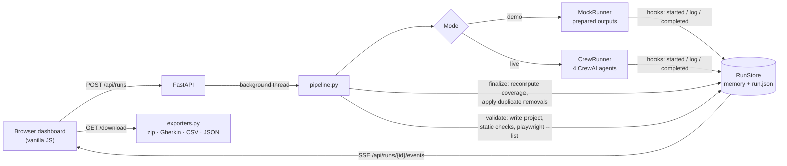

# Req2Test Crew

**Turn a user story or PRD into reviewed, runnable Playwright (TypeScript) tests, written by a crew of four AI agents while you watch.**

Paste a requirement and four agents built with [CrewAI](https://www.crewai.com/) work through it in order. One extracts acceptance criteria, one designs test cases, one writes Page Object based Playwright code, and one reviews the whole suite for gaps, duplicates and weak assertions. Progress streams live to an animated dashboard. The finished suite is validated, traceable back to each requirement, and ready to export.

```
 Requirement ──▶ Requirements Analyst ──▶ Test Designer ──▶ Script Writer ──▶ Reviewer ──▶ Validated Playwright project
                 acceptance criteria      positive /        page objects +    coverage gaps,
                 + open questions         negative / edge   Playwright specs  duplicates, weak
                                          test cases                          assertions fixed
```

> **No API key needed to try it.** Demo mode replays prepared agent outputs through the real pipeline, so you can explore every feature in a couple of minutes.

---

## Table of contents

- [Why this exists](#why-this-exists)
- [Features](#features)
- [Quick start (demo mode)](#quick-start-demo-mode)
- [Live mode (CrewAI + Groq)](#live-mode-crewai--groq)
- [Configuration](#configuration)
- [Using the dashboard](#using-the-dashboard)
- [What you get: the generated project](#what-you-get-the-generated-project)
- [How it works](#how-it-works)
- [The four agents](#the-four-agents)
- [Validation and quality checks](#validation-and-quality-checks)
- [Exports](#exports)
- [REST API](#rest-api)
- [Event stream (SSE)](#event-stream-sse)
- [Data model](#data-model)
- [Project structure](#project-structure)
- [Tech stack](#tech-stack)
- [Customising](#customising)
- [Troubleshooting](#troubleshooting)
- [Security](#security)
- [Limitations](#limitations)
- [Contributing](#contributing)

---

## Why this exists

Writing end-to-end tests from requirements is slow and easy to get wrong. Criteria get missed, tests get duplicated, and some tests click through a flow without ever asserting anything. Req2Test Crew automates the first draft and builds in the reviews a QA lead would do:

- **Ambiguity is surfaced, not guessed.** Unclear requirements become *open questions* to take back to the product owner.
- **Every test traces back to a requirement.** A traceability matrix shows which criteria are covered and which are not.
- **The numbers are trustworthy.** Coverage, duplicate removal and code checks are **recomputed in code** from the actual output, not taken from the model's own summary.

---

## Features

| Area | What you get |
|---|---|
| **Input** | Paste text, upload a `.txt` / `.md` file (up to 200 KB), or import a Jira Cloud issue by key |
| **Run settings** | Application base URL, coverage depth (Standard / Thorough), test types (positive, negative, edge), optional Gherkin export |
| **Live pipeline** | Four agent cards with live status, a streaming activity log, per-agent metrics and timings, and an overall progress bar |
| **Requirements** | Atomic acceptance criteria (`AC-1`…) with open questions flagged per criterion |
| **Test cases** | Structured cases (`TC-001`…) with type, priority (P0–P2), steps and expected result; search, type filters and a detail drawer showing the generated code for each test |
| **Traceability** | Requirement × test matrix; uncovered criteria are highlighted |
| **Playwright code** | Page Object Model TypeScript with syntax highlighting, a file browser and one-click copy |
| **Review** | Coverage gauge, coverage gaps with suggested fixes, duplicates merged, weak assertions fixed |
| **Code checks** | Assertions in every test, no hard waits, TC ids in titles, every case implemented, resilient locators, plus an optional `playwright test --list` |
| **Export** | Playwright project `.zip`, Gherkin `.feature`, CSV (TestRail / Qase / Xray import) and full JSON |
| **History** | Every run is saved to disk and can be replayed exactly as it streamed, edited and re-run, or deleted |
| **Navigation** | Floating top bar and a **command palette** (`Ctrl/⌘ + K`) for runs, samples and actions |

### The interface

The dashboard is a single page in vanilla JavaScript with no build step and a dark "mission control" design:

- Animated aurora background with a live constellation that reacts to the cursor
- Floating glass navigation bar with a sliding selection pill (no sidebar)
- Hero headline that animates in word by word, and an animated preview of the agent crew
- Pipeline cards with spinning borders, pulsing halos, typing cursors and data packets that travel between agents
- Count-up metrics, a coverage ring that draws itself, and staggered entrance animations for rows and matrix cells
- Cards that glow where the cursor points, a springy drawer, menus and notifications, and confetti when a live run completes
- Responsive down to phone width; honours **prefers-reduced-motion** by switching animations off

Rendering uses a small DOM morphing step. Live updates only touch nodes that changed, so animations never restart or flicker mid-run and the cursor stays where it was while you type.

---

## Quick start (demo mode)

**Requirements:** Python 3.11+ (tested with 3.12). Node.js is optional (see [Playwright check](#optional-playwright-discovery-check)).

**macOS / Linux**

```bash
git clone https://github.com/Prashasthi-18/Req2Test.git
cd Req2Test
python -m venv .venv && source .venv/bin/activate
pip install -r backend/requirements.txt
cp backend/.env.example backend/.env          # MOCK_MODE=true by default
cd backend
uvicorn app.main:app --reload --port 8000
```

**Windows (PowerShell)**

```powershell
git clone https://github.com/Prashasthi-18/Req2Test.git
cd Req2Test
python -m venv .venv
.venv\Scripts\activate
pip install -r backend\requirements.txt
copy backend\.env.example backend\.env
cd backend
uvicorn app.main:app --reload --port 8000
```

Open **http://localhost:8000**, pick a sample (or press `Ctrl/⌘ + K`), then press **Generate tests** (`Ctrl/⌘ + Enter`).

**What demo mode does:** it picks the closest of three prepared samples (*login with account lockout*, *checkout with promo code*, *new account sign-up*) by keyword match and streams their agent outputs with realistic pacing. Everything else is the real code path: the reviewer logic, coverage maths, duplicate detection, file generation, validation, persistence and exports.

---

## Live mode (CrewAI + Groq)

Live mode sends your own requirement text to a real LLM through CrewAI.

1. Install the extra dependency:
   ```bash
   pip install -r backend/requirements-live.txt     # adds crewai
   ```
2. Get a free API key from [console.groq.com/keys](https://console.groq.com/keys).
3. Edit `backend/.env`:
   ```ini
   MOCK_MODE=false
   GROQ_API_KEY=your_groq_api_key_here
   # optional, any CrewAI / LiteLLM model string
   LLM_MODEL=groq/llama-3.3-70b-versatile
   ```
4. Restart the server. The top bar now shows **Live · *model name*** instead of **Demo mode**.

The crew uses `temperature=0.2` and up to 8,000 output tokens per call. If the first attempt fails (for example on a transient rate limit) it retries once, then shows a plain-language error: rate limited, rejected API key, or output that didn't match the expected format.

---

## Configuration

All settings live in `backend/.env` (copied from `backend/.env.example`). It is git-ignored.

| Variable | Default | Description |
|---|---|---|
| `MOCK_MODE` | *auto* | `true` = demo mode, `false` = live mode. If unset, demo is used when no `GROQ_API_KEY` is present, otherwise live |
| `GROQ_API_KEY` | none | Groq API key, required for live mode |
| `LLM_MODEL` | `groq/llama-3.3-70b-versatile` | Any CrewAI / LiteLLM model identifier |
| `JIRA_BASE_URL` | none | e.g. `https://your-team.atlassian.net` (enables Jira import) |
| `JIRA_EMAIL` | none | Atlassian account email |
| `JIRA_API_TOKEN` | none | Atlassian API token ([create one](https://id.atlassian.com/manage-profile/security/api-tokens)) |

### Jira import

With all three `JIRA_*` variables set, open **New run → Import from Jira** and enter an issue key such as `PROJ-123`. The issue's summary and description are pulled through the Jira Cloud REST API v2 and placed in the editor.

### Optional: Playwright discovery check

The validator always runs static checks. To also have every generated project parsed by Playwright (`npx playwright test --list`), install Playwright once inside `output/`:

```bash
cd output
npm init -y
npm install @playwright/test @types/node typescript
```

Generated run folders live under `output/runs/`, so they share this installation. Without it, the check is reported as *skipped* with instructions.

---

## Using the dashboard

| Page | How to get there | What it shows |
|---|---|---|
| **New run** | Top bar → *New run* | Requirement editor (paste / upload / Jira), samples, run settings |
| **Run** | After starting a run, or from history | Live pipeline and activity log, KPI tiles, and the *Requirements · Test cases · Traceability · Playwright code · Review* tabs, plus Export and *Edit and re-run* |
| **History** | Top bar → *History* | Totals (runs, tests generated, average coverage) and every saved run with its status and coverage |

The KPI tiles show acceptance criteria, test cases, generated files, requirement coverage and code checks passed. The view switches tabs automatically as each agent finishes; clicking a tab yourself stops that.

### Keyboard shortcuts

| Keys | Action |
|---|---|
| `Ctrl/⌘ + K` | Open or close the command palette |
| `↑` `↓` `Enter` | Move through and open palette items |
| `Ctrl/⌘ + Enter` | Start a run (on the New run page) |
| `/` | Focus test search (Test cases tab) |
| `Enter` / `Space` | Open the focused test case |
| `Esc` | Close the palette, drawer or menu |

---

## What you get: the generated project

Each completed run writes a self-contained Playwright project to `output/runs/<run-id>/`:

```
output/runs/<run-id>/
├── run.json               # full run record: inputs, event log, results
├── package.json           # @playwright/test, typescript, @types/node
├── playwright.config.ts   # baseURL from your settings (overridable with BASE_URL)
├── tsconfig.json
├── pages/
│   └── LoginPage.ts       # Page Object(s)
└── tests/
    └── login.spec.ts      # one test per test case, titled "TC-001 …"
```

To run it against your application (unzip the export or use the folder directly):

```bash
npm install
npx playwright install chromium
BASE_URL=http://localhost:3000 npx playwright test       # PowerShell: $env:BASE_URL="..."; npx playwright test
```

The config enables parallel runs, two retries on CI, `list` and `html` reporters, traces on first retry, and a Desktop Chrome project.

> Selectors and test data are derived from the requirement text (role, label and test-id locators). Review the page objects in `pages/` and adjust them to your real DOM before relying on the results.

---

## How it works



1. **Submit.** The browser POSTs the requirement and options. The server creates a run and starts the pipeline in a background thread, returning `202` with a `run_id` straight away.
2. **Run agents.** The selected runner (demo or live) reports progress through `Hooks`, and each call appends an event to the run's ordered event log.
3. **Finalize deterministically.** `pipeline.finalize()` applies the reviewer's duplicate removals, **recomputes coverage** from the real criteria and tests, and adds a gap entry for any uncovered criterion the reviewer missed.
4. **Validate.** `validator.py` writes the Playwright project to disk (rejecting unsafe file paths), runs the static checks, and runs `playwright test --list` if Playwright is installed.
5. **Persist.** The full run, including every event, is saved to `output/runs/<id>/run.json`. Runs are reloaded on startup; any run that was mid-flight when the server stopped is marked failed.
6. **Stream.** The UI is driven only by the event stream. Opening a past run replays its stored events through the same code path, so live and historical views are identical, and a dropped connection resumes from the last event id.

---

## The four agents

Agents run **sequentially**. Each task receives the outputs of the earlier tasks as context and must return typed JSON enforced by a Pydantic model (`output_pydantic`).

| # | Agent | Input | Output model | Responsibility |
|---|---|---|---|---|
| 1 | **Requirements Analyst** | Requirement text | `CriteriaOut` | Feature name, atomic acceptance criteria, an `ambiguity_note` for anything unclear. Never invents requirements |
| 2 | **Test Designer** | Criteria, chosen types, depth | `TestCasesOut` | Positive / negative / edge cases using equivalence partitioning and boundary analysis; each with steps, an expected result and a priority |
| 3 | **Playwright Script Writer** | Criteria, test cases, base URL | `FilesOut` | Page Object + spec files; prefers `getByRole` / `getByLabel` / `getByTestId`, no fixed sleeps, at least one `expect()` per test |
| 4 | **QA Reviewer** | Everything above | `ReviewOut` | Finds coverage gaps, duplicate tests and weak assertions; returns the corrected final files and a summary |

Roles, goals and backstories are in [`backend/app/config/agents.yaml`](backend/app/config/agents.yaml); task prompts are in [`backend/app/config/tasks.yaml`](backend/app/config/tasks.yaml). **Coverage depth** changes the designer's instructions: *Standard* keeps 1–3 high-value tests per criterion, while *Thorough* adds boundary, state-transition and error-recovery cases.

---

## Validation and quality checks

Static checks run on every completed run with no extra dependencies:

| Check | Passes when |
|---|---|
| Every test has an assertion | Each `test(...)` block contains `expect(` |
| Test titles carry a TC id | Every test title includes an id like `TC-001` |
| No hard-coded waits | No `waitForTimeout`, `setTimeout` or `sleep(` in tests |
| Every test case is implemented | Every designed test case id appears in the code |
| Resilient locators | No `.locator()` calls using CSS selectors (`.`, `#`, `[`) or XPath |

In addition, **`playwright test --list`** checks that the files parse and the tests are discoverable. It reports *passed* (with the number of tests found), *failed* (with the output), or *skipped* when Node.js or Playwright isn't available.

File names returned by the model are sandboxed: absolute paths, `..` segments and extensions other than `.ts` / `.js` are rejected before anything is written.

---

## Exports

Available from **Export** on any completed run:

| Format | Contents |
|---|---|
| **Playwright project (.zip)** | `tests/`, `pages/`, `package.json`, `playwright.config.ts`, `tsconfig.json`, a `features/*.feature` file, `test-cases.csv` and a short README |
| **Gherkin (.feature)** | One `Feature`, one `Scenario` per test case, tagged `@TC-xxx @AC-x @type @priority` |
| **CSV** | `ID, Criterion, Title, Type, Priority, Steps, Expected result`. UTF-8 with BOM so Excel opens it cleanly; ready for TestRail / Qase / Xray import |
| **JSON** | The complete result: criteria, test cases, files, review and validation |

---

## REST API

Interactive docs are available at **http://localhost:8000/docs** (Swagger UI).

| Method | Path | Description |
|---|---|---|
| `GET` | `/api/config` | Mode (`demo` / `live`), model name, whether Jira is configured and whether Playwright is installed |
| `GET` | `/api/samples` | The three built-in sample requirements |
| `POST` | `/api/runs` | Start a run → `202 {"run_id": "…"}` |
| `GET` | `/api/runs` | List runs (newest first) with criteria / test counts and coverage |
| `GET` | `/api/runs/{id}` | Run metadata and result (without the event log) |
| `DELETE` | `/api/runs/{id}` | Delete a run and its generated files → `204` |
| `GET` | `/api/runs/{id}/events?from=N` | Server-Sent Events stream; replays from event `N` and then follows live |
| `GET` | `/api/runs/{id}/download?format=zip\|gherkin\|csv\|json` | Download an export (completed runs only) |
| `POST` | `/api/import/jira` | `{"key": "PROJ-123"}` → `{"key", "story"}` |

Example: start a run from the command line.

```bash
curl -X POST http://localhost:8000/api/runs \
  -H "Content-Type: application/json" \
  -d '{
        "story": "As a registered user, I want to log in with email and password so that I can see my dashboard. Lock the account after 3 failed attempts.",
        "base_url": "http://localhost:3000",
        "options": { "depth": "standard", "types": ["positive", "negative", "edge"], "gherkin": true }
      }'
```

`story` must be 20–20,000 characters, and at least one test type is required.

---

## Event stream (SSE)

Each event has the shape `{ id, type, agent, timestamp, data }`.

| Event | `agent` | `data` |
|---|---|---|
| `run_started` | none | `{ mode }` |
| `agent_started` | agent id | none |
| `agent_log` | agent id | `{ message }` |
| `agent_completed` | agent id | `{ output, summary, duration }` |
| `validation_result` | none | `{ static_checks: [...], playwright: { status, output, total } }` |
| `run_completed` | none | `{ coverage }` |
| `run_failed` | none | `{ message }` |

Agent ids are `analyst`, `designer`, `writer` and `reviewer`. The stream sends a keep-alive comment while idle and closes once the run finishes.

---

## Data model

Defined in [`backend/app/models.py`](backend/app/models.py):

```text
AcceptanceCriterion  id ("AC-1"), text, ambiguity_note?
TestCase             id ("TC-001"), criterion_id, title, type (positive|negative|edge),
                     priority (P0|P1|P2), steps[], expected
GeneratedFile        filename ("tests/login.spec.ts" | "pages/LoginPage.ts"), code
ReviewReport         gaps[{criterion_id, issue, suggestion}],
                     duplicates_removed[{removed_id, kept_id, reason}],
                     weak_assertions[{test_id, issue, fix}],
                     coverage_percent, summary
```

---

## Project structure

```
Req2Test/
├── README.md
├── .gitignore
├── backend/
│   ├── .env.example            # configuration template (no secrets)
│   ├── requirements.txt        # demo mode: fastapi, uvicorn, pydantic, dotenv, pyyaml, httpx
│   ├── requirements-live.txt   # + crewai for live mode
│   └── app/
│       ├── main.py             # FastAPI app: REST, SSE, downloads, Jira, static files
│       ├── pipeline.py         # orchestration, deterministic finalize, validation, persistence
│       ├── crew_runner.py      # live mode: sequential CrewAI crew
│       ├── mock_runner.py      # demo mode: prepared outputs + real reviewer logic
│       ├── mock_data.py        # the three samples and the Playwright code renderer
│       ├── validator.py        # writes the project, static checks, playwright --list
│       ├── exporters.py        # zip, Gherkin, CSV
│       ├── store.py            # thread-safe run store with JSON persistence
│       ├── models.py           # Pydantic schemas (API + agent outputs)
│       ├── config/
│       │   ├── agents.yaml     # agent roles, goals, backstories
│       │   └── tasks.yaml      # task prompts and expected outputs
│       └── static/
│           ├── index.html      # app shell
│           ├── styles.css      # design system and animations
│           └── app.js          # SPA: state, DOM morphing, SSE client, views, effects
└── output/
    ├── README.md
    └── runs/<run-id>/          # generated projects + run.json (git-ignored)
```

---

## Tech stack

| Layer | Technology |
|---|---|
| Backend | Python 3.11+, FastAPI, Uvicorn, Pydantic v2, python-dotenv, PyYAML, httpx |
| Agents | CrewAI (sequential process, `output_pydantic` tasks), Groq via LiteLLM by default |
| Frontend | Vanilla JavaScript (no framework, no build step), HTML, CSS, Canvas |
| Fonts | Geist, Geist Mono and Instrument Serif (Google Fonts) |
| Generated tests | Playwright Test + TypeScript, Page Object Model |
| Storage | JSON files on disk (`output/runs/`) |

---

## Customising

- **Different model or provider:** set `LLM_MODEL` to any LiteLLM identifier (for example `groq/llama-3.1-8b-instant`). For a non-Groq provider, also adjust how the API key is read in `crew_runner.py`.
- **Agent behaviour:** edit `config/agents.yaml` and `config/tasks.yaml`. Task prompts use `<<story>>`, `<<base_url>>`, `<<types>>` and `<<depth>>` placeholders.
- **New quality rules:** add a check in `static_checks()` in `validator.py`; it appears in the UI automatically.
- **New samples:** add an entry to `mock_data.py` (criteria, tests, keywords) and register it in `SAMPLES`.
- **UI changes:** edit the files in `app/static/`. After changing CSS or JS, bump the `?v=` query in `index.html` so browsers don't use stale cached copies.

---

## Troubleshooting

| Symptom | Fix |
|---|---|
| Blank light-grey page after updating the UI | Your browser cached old CSS/JS. Hard refresh with `Ctrl + Shift + R` (bump `?v=` in `index.html` when you change static files) |
| `[Errno 10048]` / *address already in use* | Another server is on port 8000. Stop it or use `--port 8001` |
| Top bar says *Demo mode* though you added a key | Set `MOCK_MODE=false` explicitly and restart the server |
| *CrewAI is not installed* | `pip install -r backend/requirements-live.txt` |
| *The model provider rate-limited this run* | Wait a minute and retry, or switch to a smaller model |
| *Output did not match the expected format* | Retry; smaller models occasionally return malformed JSON |
| `playwright test --list` shows *skipped* | Install Node.js, then run the `npm install` step in `output/` |
| A run shows *The server restarted while this run was in progress* | Expected after a restart mid-run. Use **Edit and re-run** |
| Jira import fails | Check `JIRA_BASE_URL` (no trailing path), email and API token; the issue must be visible to that account |

---

## Security

- **Never commit real keys.** `backend/.env` is git-ignored; keep `backend/.env.example` to placeholders only. GitHub push protection blocks pushes that contain Groq keys.
- If a key is ever exposed, revoke it at [console.groq.com/keys](https://console.groq.com/keys) and create a new one.
- The server has **no authentication** and is meant for local use. Don't expose it on a public network as-is.
- Generated file paths are sandboxed to the run folder, and generated code is written to disk but never executed by the server, apart from Playwright's read-only `--list`.

---

## Limitations

- Selectors and test data are inferred from the requirement text, not from your live application; adjust the page objects before running against a real app.
- `.pdf` and `.docx` upload are not supported yet; paste the text or use `.txt` / `.md`.
- Live-mode quality depends on the model. Coverage, duplicate removal and validation are recomputed in code, so those numbers stay accurate even when the model's own summary is not.
- Runs execute in background threads of a single server process; a restart marks in-progress runs as failed.
- Demo mode always maps input to one of the three prepared samples.

---

## Contributing

1. Fork the repo and create a branch: `git checkout -b feature/my-change`
2. Run the app in demo mode and check your change end to end
3. Keep secrets out of commits (`git diff --staged` before committing)
4. Open a pull request describing what changed and why

Ideas that would fit well: PDF/DOCX input, more LLM providers, running the generated suite from the UI, user authentication, and a database-backed run store.
