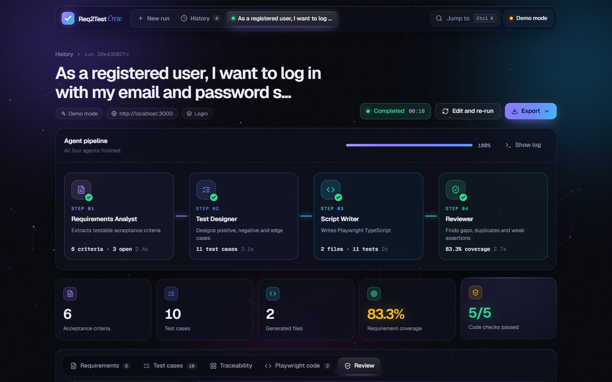
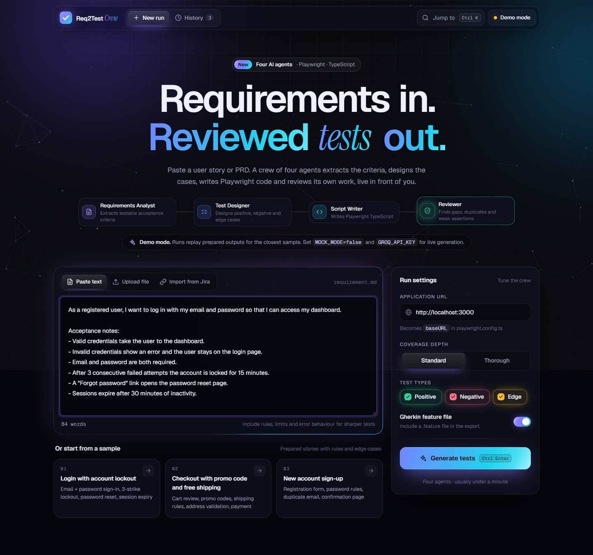
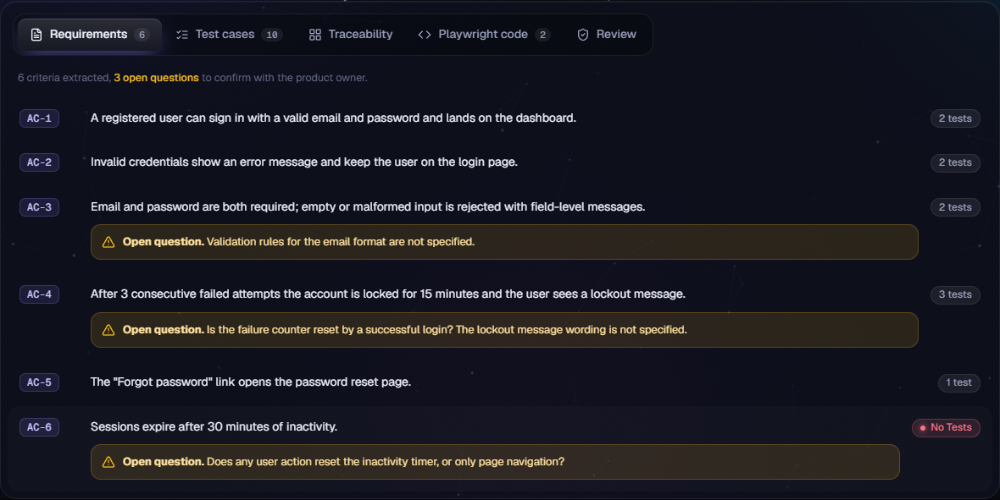
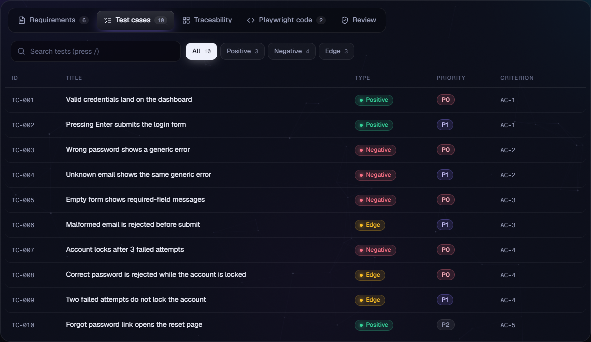
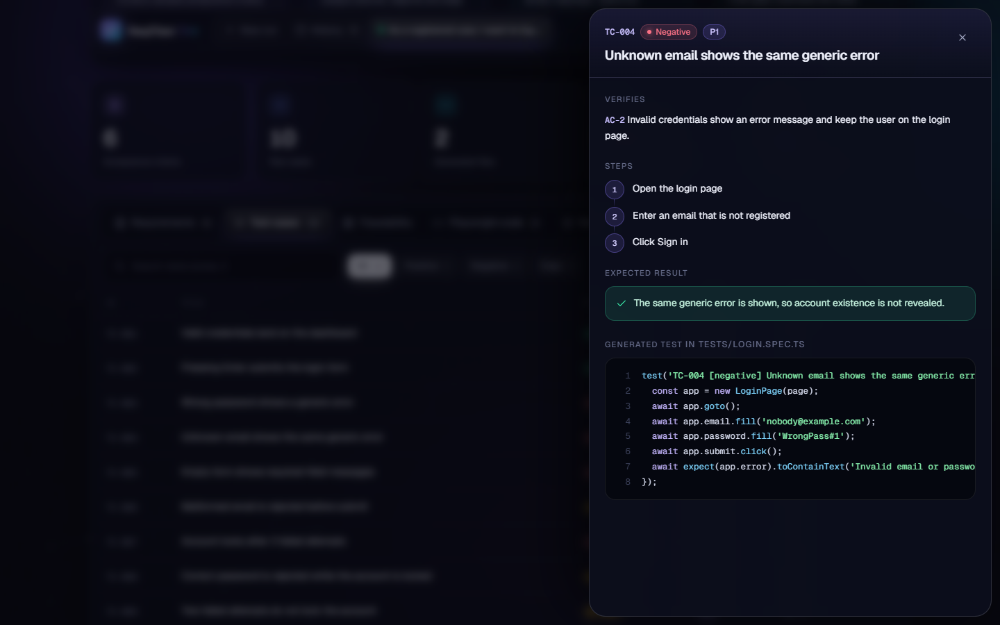
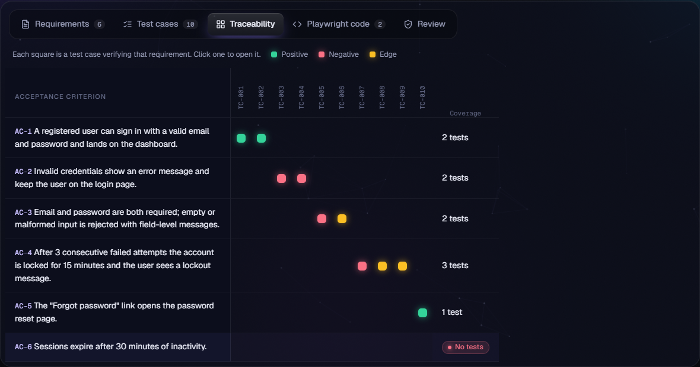
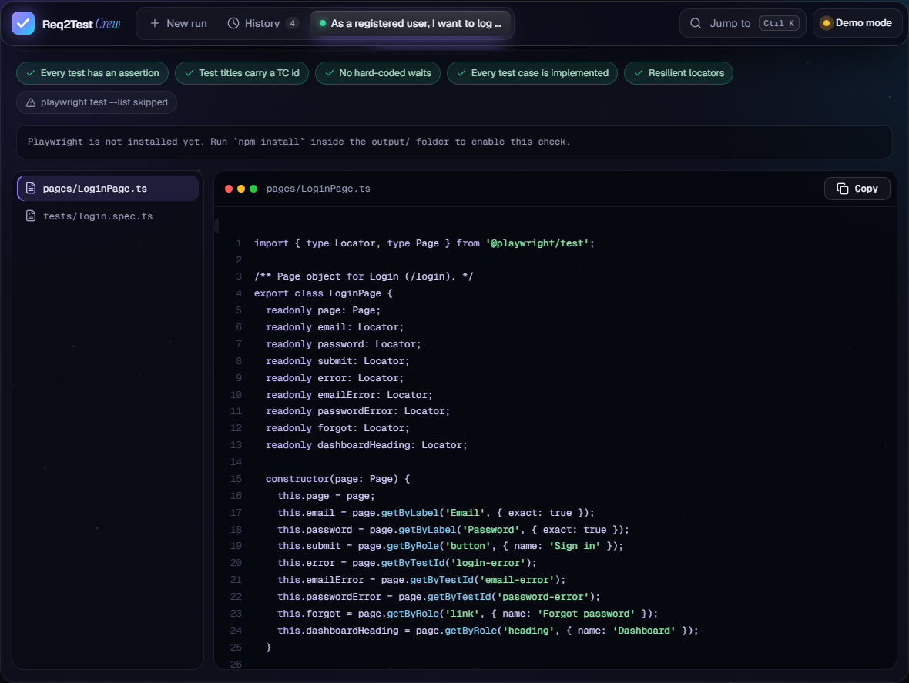
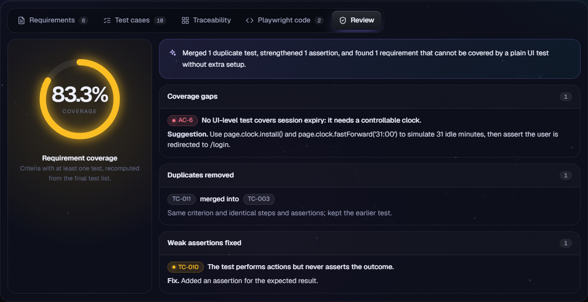
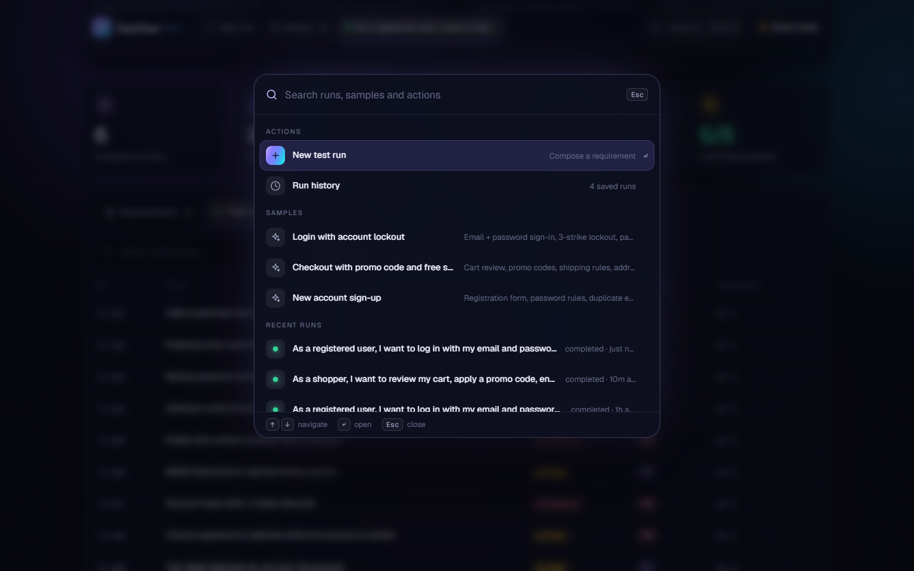
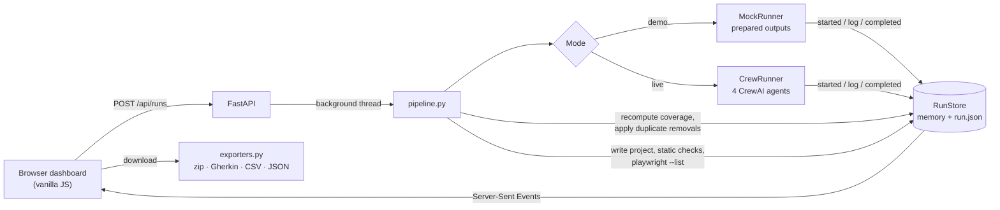

<div align="center">

# Req2Test Crew

**Paste a requirement. Get reviewed, runnable Playwright tests.**

Four AI agents read your user story, design the test cases, write the test code and review their own work, live in front of you.

**[Live demo: req2test.onrender.com](https://req2test.onrender.com/)**
<br/><sub>Hosted on Render's free tier. The first load after a quiet spell can take up to a minute while the server wakes up.</sub>




</div>

---

## What is this?

Writing end-to-end tests from a requirement document is slow, and it's easy to miss a rule, duplicate a test, or write a test that clicks through a flow without checking anything.

**Req2Test Crew automates that first draft.** You give it a user story or PRD. It gives you back:

| You get | Example |
|---|---|
| **Acceptance criteria**, with unclear points flagged as questions | `AC-4` Lock the account after 3 failed attempts · *"Is the failure counter reset by a successful login?"* |
| **Test cases**: positive, negative and edge, each with steps and an expected result | `TC-007` Account locks after 3 failed attempts · Negative · P0 |
| **Playwright TypeScript code** using the Page Object pattern | `tests/login.spec.ts`, `pages/LoginPage.ts` |
| **A review report**: coverage gaps, duplicates removed, weak assertions fixed | 83.3% coverage, plus the gap that needs extra setup and how to close it |
| **A ready-to-run project** to download | `.zip` with config, plus Gherkin, CSV (TestRail / Qase / Xray) and JSON |

### How it works, in one picture

```
  Your requirement
        │
        ▼
 ┌──────────────────┐   ┌──────────────────┐   ┌──────────────────┐   ┌──────────────────┐
 │ 1. Requirements  │──▶│ 2. Test          │──▶│ 3. Script        │──▶│ 4. Reviewer      │
 │    Analyst       │   │    Designer      │   │    Writer        │   │                  │
 │ criteria +       │   │ positive /       │   │ Playwright code  │   │ gaps, duplicates,│
 │ open questions   │   │ negative / edge  │   │ (Page Objects)   │   │ weak assertions  │
 └──────────────────┘   └──────────────────┘   └──────────────────┘   └──────────────────┘
                                                                              │
                                     coverage recomputed · code validated     ▼
                                                                    Downloadable test project
```

The numbers you see (coverage, duplicates, code checks) are **recalculated by the app from the actual output**, not copied from what the AI says about itself.

---

## See it in action

**The crew at work.** Each agent lights up while it works, hands its output to the next, and logs what it's doing:


<table>
<tr>
<td width="50%" valign="top">
<b>1. Write or pick a requirement</b><br/>
Paste text, upload a <code>.txt</code>/<code>.md</code> file or import a Jira issue, then choose the test types and coverage depth.
<br/><br/>

</td>
<td width="50%" valign="top">
<b>2. Review the acceptance criteria</b><br/>
Every rule becomes a testable criterion. Anything ambiguous is flagged as an open question for the product owner.
<br/><br/>

</td>
</tr>
<tr>
<td width="50%" valign="top">
<b>3. Browse the test cases</b><br/>
Search and filter by type. Each case has a priority, steps and an expected result.
<br/><br/>

</td>
<td width="50%" valign="top">
<b>4. Open any test to see its code</b><br/>
The drawer shows what the test verifies, its steps, and the exact Playwright test generated for it.
<br/><br/>

</td>
</tr>
<tr>
<td width="50%" valign="top">
<b>5. Check traceability</b><br/>
A matrix links every requirement to the tests that cover it, so gaps stand out immediately.
<br/><br/>

</td>
<td width="50%" valign="top">
<b>6. Read the generated code</b><br/>
Page Object based TypeScript, syntax highlighted, with automatic quality checks along the top.
<br/><br/>

</td>
</tr>
<tr>
<td width="50%" valign="top">
<b>7. Read the reviewer's report</b><br/>
Coverage score, gaps with suggested fixes, merged duplicates and strengthened assertions.
<br/><br/>

</td>
<td width="50%" valign="top">
<b>8. Jump anywhere with Ctrl/⌘ + K</b><br/>
The command palette finds past runs, samples and actions. History keeps every run so you can replay or re-run it.
<br/><br/>

</td>
</tr>
</table>

---

## Try it in 2 minutes

No API key is needed: **demo mode** replays prepared agent outputs through the real pipeline.

**Requirements:** Python 3.11 or newer.

```bash
git clone https://github.com/Prashasthi-18/Req2Test.git
cd Req2Test
python -m venv .venv
source .venv/bin/activate              # Windows: .venv\Scripts\activate
pip install -r backend/requirements.txt
cp backend/.env.example backend/.env   # Windows: copy backend\.env.example backend\.env
cd backend
uvicorn app.main:app --reload --port 8000
```

Open **http://localhost:8000**, click one of the three samples, and press **Generate tests**.

> In demo mode the app matches your text to the closest of three prepared samples (login, checkout, sign-up). Everything after the AI step is real: review logic, coverage, validation, saving and exports.

### Use a real AI model (live mode)

1. `pip install -r backend/requirements-live.txt` (adds CrewAI)
2. Get a free key at [console.groq.com/keys](https://console.groq.com/keys)
3. In `backend/.env` set:
   ```ini
   MOCK_MODE=false
   GROQ_API_KEY=your_groq_api_key_here
   ```
4. Restart the server. The top bar now shows **Live** and the model name, and any requirement you paste is processed by the crew.

### Run the generated tests against your app

Download the **Playwright project (.zip)** from the Export menu, then:

```bash
npm install
npx playwright install chromium
BASE_URL=http://localhost:3000 npx playwright test
```

Selectors are inferred from the requirement text (roles, labels and test ids), so adjust the page objects in `pages/` to match your real UI first.

---

## Features at a glance

- **Three ways to start**: paste text, upload `.txt` / `.md`, or import a Jira Cloud issue
- **Live pipeline**: agent status, streaming activity log, timings and overall progress
- **Ambiguity detection**: unclear requirements become open questions, not guesses
- **Traceability matrix**: every requirement mapped to its tests; uncovered ones highlighted
- **Automatic code checks**: assertions present, no hard waits, TC ids in titles, every case implemented, resilient locators, plus an optional `playwright test --list`
- **Exports**: Playwright project, Gherkin `.feature`, CSV for test management tools, full JSON
- **History**: every run is saved and replays exactly as it happened; edit and re-run any time
- **Polished UI**: animated dark interface, command palette, keyboard shortcuts, responsive layout, and support for the reduced-motion setting

| Shortcut | Action |
|---|---|
| `Ctrl/⌘ + K` | Command palette |
| `Ctrl/⌘ + Enter` | Start a run |
| `/` | Search test cases |
| `Esc` | Close panels |

---

## Under the hood

<details>
<summary><b>Architecture</b></summary>
<br/>



1. **Submit.** The browser posts the requirement; the server creates a run, starts the pipeline in a background thread and returns a `run_id` immediately.
2. **Run agents.** The demo or live runner reports progress through hooks; every call is appended to the run's event log.
3. **Finalize.** Duplicate removals are applied, coverage is recomputed from the real criteria and tests, and any uncovered criterion the reviewer missed is added as a gap.
4. **Validate.** The Playwright project is written to `output/runs/<id>/` (unsafe file paths are rejected), static checks run, and `playwright test --list` runs if Playwright is installed.
5. **Persist.** The full run, including every event, is saved to `run.json` and reloaded when the server starts.
6. **Stream.** The UI is driven only by the event stream, so opening a past run replays it through the same code. Live and past views are identical, and a dropped connection resumes where it left off.

</details>

<details>
<summary><b>The four agents</b></summary>
<br/>

Agents run sequentially. Each task receives the earlier outputs as context and must return typed JSON enforced by a Pydantic model.

| Agent | Output | Responsibility |
|---|---|---|
| **Requirements Analyst** | `CriteriaOut` | Atomic acceptance criteria and an `ambiguity_note` for anything unclear. Never invents requirements |
| **Test Designer** | `TestCasesOut` | Positive / negative / edge cases using equivalence partitioning and boundary analysis |
| **Playwright Script Writer** | `FilesOut` | Page Object + spec files; `getByRole` / `getByLabel` / `getByTestId`, no fixed sleeps, an `expect()` in every test |
| **QA Reviewer** | `ReviewOut` | Coverage gaps, duplicates and weak assertions, plus the corrected final files |

Prompts live in [`backend/app/config/agents.yaml`](backend/app/config/agents.yaml) and [`tasks.yaml`](backend/app/config/tasks.yaml). *Standard* depth keeps 1–3 high-value tests per criterion; *Thorough* adds boundary, state-transition and error-recovery cases.

</details>

<details>
<summary><b>Quality checks</b></summary>
<br/>

| Check | Passes when |
|---|---|
| Every test has an assertion | Each `test(...)` block contains `expect(` |
| Test titles carry a TC id | Every title includes an id like `TC-001` |
| No hard-coded waits | No `waitForTimeout`, `setTimeout` or `sleep(` |
| Every test case is implemented | Every designed test case id appears in the code |
| Resilient locators | No CSS or XPath strings passed to `.locator()` |
| `playwright test --list` *(optional)* | Files parse and tests are discoverable |

To enable the Playwright check, run once inside `output/`:
`npm init -y && npm install @playwright/test @types/node typescript`

</details>

<details>
<summary><b>Configuration</b></summary>
<br/>

All settings go in `backend/.env` (git-ignored; copy from `backend/.env.example`).

| Variable | Default | Description |
|---|---|---|
| `MOCK_MODE` | auto | `true` demo, `false` live. If unset: demo without a key, live with one |
| `GROQ_API_KEY` | none | Required for live mode |
| `LLM_MODEL` | `groq/llama-3.3-70b-versatile` | Any CrewAI / LiteLLM model id |
| `JIRA_BASE_URL` | none | e.g. `https://your-team.atlassian.net` |
| `JIRA_EMAIL` | none | Atlassian account email |
| `JIRA_API_TOKEN` | none | [Atlassian API token](https://id.atlassian.com/manage-profile/security/api-tokens) |

</details>

<details>
<summary><b>Exports</b></summary>
<br/>

| Format | Contents |
|---|---|
| Playwright project (.zip) | `tests/`, `pages/`, `package.json`, `playwright.config.ts`, `tsconfig.json`, a `.feature` file, `test-cases.csv`, README |
| Gherkin (.feature) | One scenario per test case, tagged `@TC-xxx @AC-x @type @priority` |
| CSV | `ID, Criterion, Title, Type, Priority, Steps, Expected result`; opens cleanly in Excel |
| JSON | Criteria, test cases, files, review and validation |

</details>

<details>
<summary><b>REST API and event stream</b></summary>
<br/>

Interactive docs: **http://localhost:8000/docs**

| Method | Path | Description |
|---|---|---|
| `GET` | `/api/config` | Mode, model, Jira and Playwright availability |
| `GET` | `/api/samples` | Built-in sample requirements |
| `POST` | `/api/runs` | Start a run → `202 {"run_id"}` |
| `GET` | `/api/runs` | List runs with counts and coverage |
| `GET` | `/api/runs/{id}` | Run details and result |
| `DELETE` | `/api/runs/{id}` | Delete a run and its files |
| `GET` | `/api/runs/{id}/events?from=N` | Server-Sent Events: replay, then follow live |
| `GET` | `/api/runs/{id}/download?format=zip\|gherkin\|csv\|json` | Download an export |
| `POST` | `/api/import/jira` | `{"key": "PROJ-123"}` → requirement text |

```bash
curl -X POST http://localhost:8000/api/runs -H "Content-Type: application/json" -d '{
  "story": "As a registered user, I want to log in with email and password. Lock the account after 3 failed attempts.",
  "base_url": "http://localhost:3000",
  "options": { "depth": "standard", "types": ["positive", "negative", "edge"], "gherkin": true }
}'
```

Events have the shape `{ id, type, agent, timestamp, data }`. The types are `run_started`, `agent_started`, `agent_log`, `agent_completed`, `validation_result`, `run_completed` and `run_failed`. Agent ids are `analyst`, `designer`, `writer` and `reviewer`.

</details>

<details>
<summary><b>Project structure</b></summary>
<br/>

```
Req2Test/
├── backend/
│   ├── .env.example            configuration template (no secrets)
│   ├── requirements.txt        demo mode dependencies
│   ├── requirements-live.txt   + CrewAI for live mode
│   └── app/
│       ├── main.py             FastAPI: REST, SSE, downloads, Jira, static files
│       ├── pipeline.py         orchestration, finalize, validation, persistence
│       ├── crew_runner.py      live mode: sequential CrewAI crew
│       ├── mock_runner.py      demo mode: prepared outputs + real reviewer logic
│       ├── mock_data.py        the three samples and the code renderer
│       ├── validator.py        writes the project, static checks, playwright --list
│       ├── exporters.py        zip, Gherkin, CSV
│       ├── store.py            thread-safe run store with JSON persistence
│       ├── models.py           Pydantic schemas
│       ├── config/             agents.yaml, tasks.yaml
│       └── static/             index.html, styles.css, app.js (no build step)
├── docs/screenshots/           images used in this README
└── output/runs/<id>/           generated projects (git-ignored)
```

**Stack:** Python, FastAPI, Uvicorn, Pydantic v2, CrewAI, Groq (via LiteLLM), vanilla JavaScript, HTML, CSS, Canvas, Playwright Test, TypeScript.

</details>

<details>
<summary><b>Customising</b></summary>
<br/>

- **Model:** set `LLM_MODEL` to any LiteLLM id; for another provider, adjust how the key is read in `crew_runner.py`
- **Agent behaviour:** edit `config/agents.yaml` and `config/tasks.yaml` (placeholders: `<<story>>`, `<<base_url>>`, `<<types>>`, `<<depth>>`)
- **New quality rule:** add it to `static_checks()` in `validator.py`; it appears in the UI automatically
- **New demo sample:** add it to `mock_data.py` and register it in `SAMPLES`
- **UI:** edit `app/static/`, then bump the `?v=` number in `index.html` so browsers load the new files

</details>

<details>
<summary><b>Troubleshooting</b></summary>
<br/>

| Problem | Fix |
|---|---|
| Blank page after updating the UI | The browser cached old files. Hard refresh with `Ctrl + Shift + R` |
| `address already in use` on port 8000 | Another server is running. Stop it or use `--port 8001` |
| Still shows *Demo mode* after adding a key | Set `MOCK_MODE=false` explicitly and restart |
| *CrewAI is not installed* | `pip install -r backend/requirements-live.txt` |
| *Rate-limited* or *output did not match the expected format* | Wait a minute and retry, or try another model |
| `playwright test --list` shows *skipped* | Install Node.js and run the `npm install` step in `output/` |
| Jira import fails | Check `JIRA_BASE_URL`, email and token; the issue must be visible to that account |

</details>

---

## Security and limitations

- Keep real keys in `backend/.env` only (it's git-ignored); `.env.example` must contain placeholders.
- The server has **no authentication** and is meant for local use.
- Generated file paths are sandboxed to the run folder. Generated code is never executed, apart from Playwright's read-only `--list`.
- Selectors come from the requirement text, not your live app, so review the page objects before relying on them.
- `.pdf` and `.docx` upload are not supported yet.
- In-progress runs are marked failed if the server restarts.

## Contributing

Fork the repo, create a branch, check your change end to end in demo mode, and open a pull request. Ideas that fit well: PDF/DOCX input, more LLM providers, running the generated suite from the UI, and authentication.
